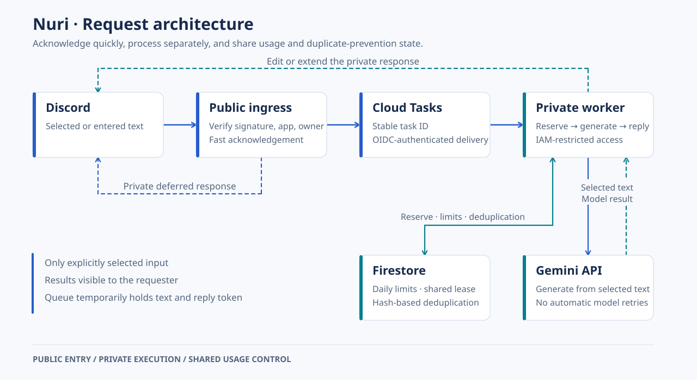

# Nuri Translate

**Understand the text you choose. Then write a sentence of your own.**


[한국어](README.md) · **English** · [简体中文](README.zh-CN.md)

Nuri is a personal Discord app for translation and English practice. It reads text in the selected message, including message cards, and puts translations and corrections first. Replies are visible only to the requester.

[GitHub Wiki](https://github.com/chquan17-bit/nuri-translate/wiki/Home-en) · [Deployment](docs/DEPLOYMENT.md) · [Validation](VALIDATION.md) · [Changelog](CHANGELOG.md)

> Korean, English, and Simplified Chinese guides are available in the official GitHub Wiki. Sources are versioned with the code under `docs/wiki/`. Making the source public does not change bot access or cloud settings: the running bot remains owner-only, and replies remain visible only to the requester.

## From understanding to practice

| Goal | Discord action | Result |
| --- | --- | --- |
| Understand selected text | Message → Apps → **Nuri 번역** | Translation → source |
| Learn reusable expressions | **Nuri와 영어 배우기** | Translation → up to 2 expressions → source |
| Write a sentence yourself | **한 문장 써보기** button | Correction → focused feedback → your sentence |
| Paste your own text | **`/nuri`** | Translation or English learning |

Nuri combines message content with embed titles, descriptions, and fields. Mention-only input gets guidance without a model call. External web pages, images, and attachments are not fetched automatically.

Combined input is limited to 3,000 characters; practice sentences to 1,000. Short results fit in one reply. Longer results are split into at most six replies within Discord's UTF-16 limits, with a notice if further output is omitted. Practice buttons expire after ten minutes and are bound to the requester.

## Architecture



Cloud Run is the primary runtime, independent of the user's PC. A Windows Gateway runner is retained for recovery.

| Setting | Operating policy |
| --- | --- |
| Scaling and billing | Request-based; minimum 0 and maximum 1 instance per service |
| Resources | 1 CPU and 512 MiB per service |
| Default limits | 25 requests per day · 10-second cooldown · 1 concurrent translation |
| Model | Gemini `gemini-3.5-flash-lite`; no automatic generation retries |
| Persistent state | Firestore preserves limits, cooldowns, and duplicate protection across restarts |
| Recovery | Windows Gateway with DPAPI credential storage |

**Known limitation:** after an idle period, ingress startup can exceed Discord's three-second initial response deadline. This remains possible with minimum instances set to zero. A successful warm-server check does not establish that cold starts are fixed.

Cloud Tasks delivery retries are separate from model-generation retries. Failed attempts count once model processing begins. Daily counters reset at midnight in Korea. A request cap is not a spending cap, and request-based billing does not make every cloud cost free.

## Data and credentials

Only text selected or entered by the user is processed. The local Gateway permits the application owner by default and supports an explicit allowlist. Cloud Run permits only the single owner identified by `NURI_OWNER_ID`.

Source text and short-lived Discord response tokens are temporarily held by Cloud Tasks for processing. Application logs and Firestore usage records do not store source text, translations, keys, or tokens. The worker obtains its Gemini API key through Secret Manager; the cloud runtime does not need a Discord Bot Token. Data sent to Google is subject to the API's applicable terms.

Local state, virtual environments, real environment files, credentials, status records, and personal screenshots are excluded from Git and container builds. `.env.example` is a reference only; Python does not load it automatically.

## Development

Install Python 3.13 and uv, then run from the repository root:

```powershell
uv --cache-dir .state/uv-cache sync --frozen
.\.venv\Scripts\python.exe -m unittest discover -s tests -q
.\.venv\Scripts\python.exe -m nuri doctor
```

`uv.lock` pins development dependencies; `requirements-cloud.txt` pins container dependencies with hashes. Tests do not call a real model. Release preparation on 2026-10-27 passed 121 tests; consult the release record for build and deployment verification.

## Windows recovery

Follow the [recovery procedure](docs/DEPLOYMENT.md#로컬-gateway-복구) before switching from Cloud Run. Confirm the intended Discord application and its code-level app validation, User Install, and `applications.commands` configuration. Enter credentials through `Configure-Nuri.cmd`, inspect configuration with `Check-Nuri.cmd`, register commands only when needed with `Register-Nuri.cmd`, then run `Start-Nuri.cmd` after the endpoint transition.

Credentials are DPAPI-encrypted in `.state/secrets.xml` for the same Windows user. Local usage is stored in `.state/usage.sqlite`; translations are not saved as learning history. Local operation requires the PC and process to remain running. Stop with `Ctrl+C`.
