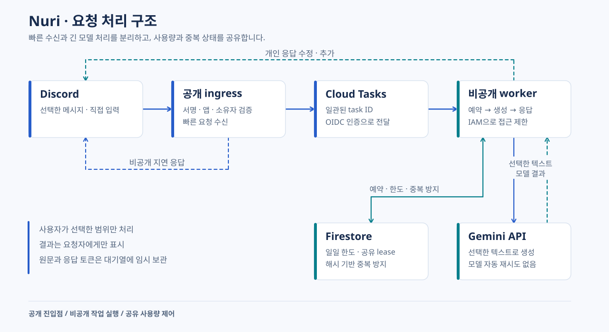

# Nuri 번역

**선택한 글을 이해하고, 다음 문장을 직접 써보세요.**


**한국어** · [English](README.en.md) · [简体中文](README.zh-CN.md)

Nuri는 Discord에서 선택한 글을 번역하고 영어 표현을 연습하는 개인 앱입니다. 메시지 카드에 들어 있는 본문까지 읽고, 번역과 교정을 먼저 보여줍니다. 결과는 요청자에게만 표시됩니다.

[문서·Wiki](docs/wiki/Home-ko.md) · [배포 안내](docs/DEPLOYMENT.md) · [검증 안내](VALIDATION.md) · [변경 기록](CHANGELOG.md)

> 문서는 코드와 함께 버전 관리됩니다. 현재 GitHub 요금제에서는 이 비공개 저장소의 Wiki 탭을 사용할 수 없어, 3개 언어 Wiki를 저장소의 `docs/wiki/`에 제공합니다.

## 이해에서 연습까지

| 하고 싶은 일 | Discord에서 실행 | 받는 결과 |
| --- | --- | --- |
| 선택한 글 이해하기 | 메시지 → Apps → **Nuri 번역** | 번역 → 원문 |
| 다시 쓸 표현 배우기 | **Nuri와 영어 배우기** | 번역 → 표현 최대 2개 → 원문 |
| 직접 한 문장 써보기 | 결과의 **한 문장 써보기** | 교정 → 핵심 피드백 → 작성 문장 |
| 글을 직접 붙여 넣기 | **`/nuri`** | 번역 또는 영어 학습 |

선택한 메시지의 본문과 embed 제목·설명·필드를 함께 처리합니다. 멘션만 있으면 모델을 호출하지 않고 안내합니다. 외부 링크의 페이지, 이미지, 첨부파일은 자동으로 가져오지 않습니다.

입력은 합산 3,000자, 연습 문장은 1,000자까지 받습니다. 짧은 결과는 한 메시지로, 긴 결과는 Discord의 UTF-16 길이 제한에 맞춰 최대 6개 메시지로 표시합니다. 이를 넘는 출력은 생략 안내를 표시합니다. 연습 버튼은 10분 뒤 만료되며 다른 사용자가 사용할 수 없습니다.

## 운영 구조



Cloud Run이 기본 운영 경로입니다. PC를 끄거나 재부팅해도 서비스를 사용할 수 있으며 Windows Gateway 실행기는 복구용으로 유지합니다.

| 항목 | 운영 기준 |
| --- | --- |
| 실행 | 두 서비스 모두 요청 기반 과금, 최소 0·최대 1 인스턴스 |
| 자원 | 서비스별 CPU 1·메모리 512 MiB |
| 사용량 | 기본 하루 25회 · 요청 간 10초 · 동시 번역 1개 |
| 모델 | Gemini `gemini-3.5-flash-lite` · 생성 자동 재시도 없음 |
| 지속 상태 | Firestore로 한도·쿨다운·중복 방지를 재시작 이후에도 유지 |
| 복구 | Windows 로컬 Gateway 및 DPAPI 자격 증명 저장 |

**알려진 제한:** 오래 유휴 상태였던 ingress의 첫 기동이 Discord의 3초 초기 응답 제한을 넘을 수 있습니다. 최소 인스턴스 0을 유지하는 현재 방식에서 이 문제가 남아 있습니다. 준비된 서버에서의 성공이 첫 기동 문제 해결을 의미하지는 않습니다.

Cloud Tasks의 작업 전달 재시도와 Gemini 생성 재시도는 별개입니다. 모델 요청을 시작한 뒤 실패한 경우에도 하루 사용량을 차감하고, 날짜는 한국 시간 자정에 바뀝니다. 일일 요청 제한은 금액 상한이 아니며 요청 기반 과금도 모든 클라우드 비용이 무료라는 의미는 아닙니다.

## 데이터와 자격 증명

앱은 선택하거나 직접 입력한 텍스트만 처리합니다. 로컬 Gateway의 기본 사용자는 앱 소유자이며 명시적인 허용 목록을 추가할 수 있습니다. Cloud Run에서는 `NURI_OWNER_ID`로 지정한 소유자 한 명만 허용합니다.

원문과 짧게 유효한 Discord 응답 토큰은 Cloud Tasks에 처리 동안 일시 보관됩니다. 애플리케이션 로그와 Firestore 사용량 기록에는 원문·번역·키·토큰을 저장하지 않습니다. Gemini API 키는 worker의 Secret Manager 참조로 제공하며 클라우드 실행에는 Discord Bot Token이 필요하지 않습니다. Google로 전송된 데이터는 사용하는 API의 이용 조건에 따라 처리됩니다.

`.state/`, `.venv/`, 실제 `.env`, 로컬 자격 증명, 운영 상태, 개인 화면은 Git과 컨테이너 빌드 대상에서 제외합니다. `.env.example`은 참고용이며 Python이 자동으로 읽지 않습니다.

## 개발과 검증

Python 3.13과 uv를 준비한 뒤 저장소 루트에서 실행합니다.

```powershell
uv --cache-dir .state/uv-cache sync --frozen
.\.venv\Scripts\python.exe -m unittest discover -s tests -q
.\.venv\Scripts\python.exe -m nuri doctor
```

`uv.lock`은 개발 의존성을, `requirements-cloud.txt`는 컨테이너 설치 버전과 해시를 고정합니다. 테스트는 실제 모델을 호출하지 않습니다. 2026-10-27 릴리스 준비 검증에서 121개 테스트가 통과했습니다. 빌드와 배포 검증은 해당 릴리스 기록에서 확인합니다.

## Windows 로컬 복구

Cloud Run 운영 중에는 `Start-Nuri.cmd`를 실행할 필요가 없습니다. Gateway로 전환할 때는 [복구 절차](docs/DEPLOYMENT.md#로컬-gateway-복구)를 먼저 확인합니다.

1. 대상 Discord 앱 ID와 User Install·`applications.commands` 설정을 확인합니다. 일반 사용자 계정 토큰은 사용하지 않습니다.
2. `Configure-Nuri.cmd` 입력창에서 Gemini API 키와 Discord Bot Token을 설정합니다. 같은 Windows 사용자만 복호화할 수 있는 DPAPI 형식으로 `.state/secrets.xml`에 저장됩니다.
3. `Check-Nuri.cmd`로 설정을 확인합니다. 비밀 값은 표시하지 않으며 외부 요청을 보내지 않습니다.
4. 명령 등록이 필요할 때만 `Register-Nuri.cmd`를 실행합니다. 코드의 대상 앱 검증과 실제 앱이 일치해야 합니다.
5. 전환을 마친 뒤 `Start-Nuri.cmd`로 실행합니다. 종료는 `Ctrl+C`이며 로컬 운영에서는 PC와 프로세스가 켜져 있어야 합니다.

로컬 사용량은 `.state/usage.sqlite`에 보관합니다. 원문·번역을 학습 기록으로 저장하는 기능은 없습니다.
