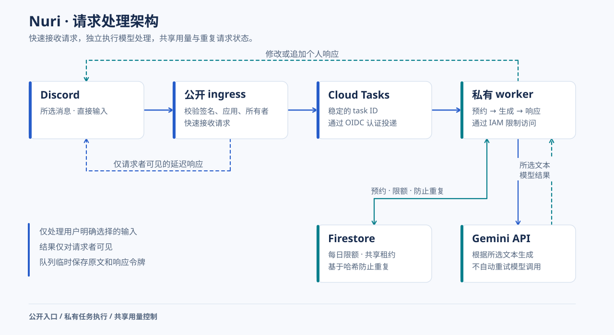

# Nuri 翻译

**读懂所选内容，再亲手写出下一句话。**


[한국어](README.md) · [English](README.en.md) · **简体中文**

Nuri 是用于个人翻译和英语练习的 Discord 应用。它读取所选消息及消息卡片中的文字，优先展示译文和修改建议。所有结果仅对发起请求的用户可见。

[GitHub Wiki](https://github.com/chquan17-bit/nuri-translate/wiki/Home-zh-CN) · [部署说明](docs/DEPLOYMENT.md) · [验证说明](VALIDATION.md) · [更新日志](CHANGELOG.md)

> 韩语、英语和简体中文指南已提供在正式 GitHub Wiki 中。文档源文件位于 `docs/wiki/`，与代码一起进行版本管理。公开源码不会改变机器人使用权限或云配置：运行中的机器人仍仅限所有者使用，回复也仅对请求者可见。

## 从理解到练习

| 目标 | Discord 操作 | 获得的结果 |
| --- | --- | --- |
| 理解所选文字 | 消息 → Apps → **Nuri 번역** | 译文 → 原文 |
| 学习可复用的表达 | **Nuri와 영어 배우기** | 译文 → 最多 2 个表达 → 原文 |
| 自己写一句英语 | 结果中的 **한 문장 써보기** 按钮 | 修改建议 → 重点反馈 → 所写句子 |
| 粘贴自己的文字 | **`/nuri`** | 翻译或英语学习 |

Nuri 会合并消息正文与 embed 卡片的标题、描述和字段内容。只有提及信息的消息会收到提示，不会调用模型。它不会自动抓取外部网页、图片或附件。

合并输入上限为 3,000 字符，练习句子上限为 1,000 字符。较短结果使用一条回复；较长结果按 Discord 的 UTF-16 长度限制拆分，最多六条，超出部分会显示省略提示。练习按钮十分钟后失效，且仅限请求者使用。

## 运行结构



默认通过 Cloud Run 运行，不依赖用户的电脑持续开机。Windows Gateway 启动器保留作为恢复方式。

| 项目 | 运行策略 |
| --- | --- |
| 扩缩容与计费 | 两个服务均按请求计费；最少 0 个、最多 1 个实例 |
| 资源 | 每个服务 1 CPU、512 MiB 内存 |
| 默认额度 | 每日 25 次 · 请求间隔 10 秒 · 同时处理 1 次翻译 |
| 模型 | Gemini `gemini-3.5-flash-lite`；不自动重试生成 |
| 持久状态 | Firestore 在重启后保留额度、冷却时间和重复生成保护 |
| 恢复 | Windows Gateway 与 DPAPI 凭据存储 |

**已知限制：** 长时间空闲后的 ingress 首次启动可能超过 Discord 的三秒初始响应时限。最小实例数保持为零时，此问题仍可能发生。预热后验证成功不代表冷启动问题已经解决。

Cloud Tasks 的投递重试与模型生成重试是两回事。开始模型处理后，即使失败也计入每日额度；每日计数按韩国时间零点重置。请求次数限制不等于费用上限，按请求计费也不意味着所有云资源都免费。

## 数据与凭据

应用只处理用户选择或输入的文字。本地 Gateway 默认允许应用所有者使用，也可配置明确的允许名单。Cloud Run 仅允许 `NURI_OWNER_ID` 指定的一位所有者使用。

原文和短期有效的 Discord 响应令牌会在 Cloud Tasks 中暂存以完成处理。应用日志和 Firestore 使用记录不保存原文、译文、密钥或令牌。worker 通过 Secret Manager 获取 Gemini API 密钥；云端运行不需要 Discord Bot Token。发送给 Google 的数据适用所用 API 的相关条款。

本地状态、虚拟环境、实际环境文件、凭据、运行记录和个人截图均不纳入 Git 或容器构建。`.env.example` 仅供参考，Python 不会自动读取它。

## 开发与验证

准备 Python 3.13 和 uv 后，在仓库根目录运行：

```powershell
uv --cache-dir .state/uv-cache sync --frozen
.\.venv\Scripts\python.exe -m unittest discover -s tests -q
.\.venv\Scripts\python.exe -m nuri doctor
```

`uv.lock` 固定开发依赖，`requirements-cloud.txt` 通过版本与哈希固定容器依赖。测试不会调用真实模型。2026-10-27 发布准备阶段已通过 121 项测试；构建和部署验证请以对应发布记录为准。

## Windows 恢复

从 Cloud Run 切换前，先阅读[恢复步骤](docs/DEPLOYMENT.md#로컬-gateway-복구)。确认目标 Discord 应用与代码中的应用校验一致，并核实 User Install 和 `applications.commands` 设置。使用 `Configure-Nuri.cmd` 输入凭据，使用 `Check-Nuri.cmd` 检查配置，仅在需要时通过 `Register-Nuri.cmd` 注册命令，完成 endpoint 切换后再运行 `Start-Nuri.cmd`。

凭据通过 DPAPI 加密，保存在 `.state/secrets.xml`，仅同一 Windows 用户可解密。本地使用量保存在 `.state/usage.sqlite`；原文和译文不会作为学习记录保存。本地运行期间电脑和进程必须保持开启，可按 `Ctrl+C` 停止。
