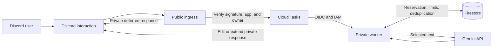
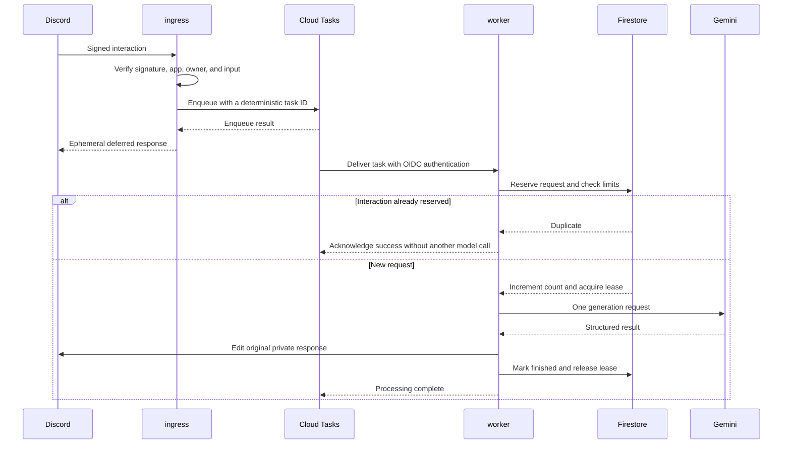

[Language selection](Home.md) · [한국어](Architecture.md) · [English](Architecture-en.md) · [简体中文](Architecture-zh-CN.md)

# Architecture

**Fast request acknowledgement and longer model processing run separately. Firestore shares usage limits and duplicate-prevention state.**

## System overview

## Components

| Component | Responsibility | Implementation |
|---|---|---|
| HTTP ingress | Validate signature, app, owner, and input; enqueue work; acknowledge with a deferred response | `nuri/cloud_http.py` |
| Task queue adapter | Stable task IDs, OIDC requests, bounded enqueue time | `nuri/cloud_queue.py` |
| Worker | Revalidate input, reserve usage, call the model, deliver private results | `nuri/cloud_http.py` |
| Shared state | Daily counts in KST, global lease, hash-based duplicate prevention | `nuri/cloud_state.py` |
| Model adapter | One generation request and structured-response validation | `nuri/provider.py` |
| Selected-message extraction | Combine message body and embed text | `nuri/selected_message.py` |
| Result rendering | Translation-first message content, pagination, Markdown escaping | `nuri/render.py` |

## Request lifecycle

A short Cloud Tasks delivery delay reduces the chance that the worker edits the result before Discord receives the initial response. The entire enqueue path is bounded to 2.3 seconds, but this does not eliminate Cloud Run instance startup time.

## Duplicates and failures

Firestore reserves an interaction **before the model call**. Redelivery of a reserved interaction never calls the model again. This also applies if the worker terminates partway through processing: the same interaction is not automatically recovered, so a response can be missed. The current policy favors preventing duplicate generation and unpredictable usage growth.

The global lease lasts 300 seconds, while actual application work has a shorter deadline. The application does not assume that a Cloud Run request timeout terminates Python work. Normal completion releases the lease; after an abnormal exit, the lease must expire before another request can proceed.

**Task delivery retries** and **Gemini generation retries** are separate. Delivery follows the existing Cloud Tasks configuration. The application does not automatically retry model generation.

**Next:** [Operations →](Operations-en.md) · [Security and data](Security-en.md)
