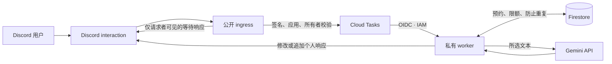
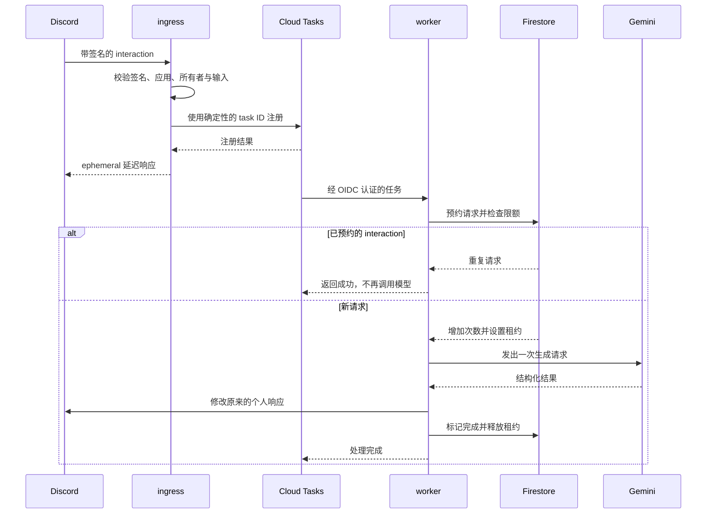

[选择语言](Home.md) · [한국어](Architecture.md) · [English](Architecture-en.md) · [简体中文](Architecture-zh-CN.md)

# 系统架构

**将快速接收请求与耗时的模型处理分开，并通过 Firestore 共享用量与重复请求状态。**

## 整体结构

## 组件职责

| 组件 | 职责 | 实现位置 |
|---|---|---|
| HTTP ingress | 校验请求签名、应用、所有者与输入，注册任务，返回延迟响应 | `nuri/cloud_http.py` |
| 任务队列 | 稳定的 task ID、OIDC 调用、注册超时控制 | `nuri/cloud_queue.py` |
| worker | 再次校验输入、预约用量、调用模型、发送个人响应 | `nuri/cloud_http.py` |
| 共享状态 | KST 每日次数、全局租约、基于哈希的重复请求检测 | `nuri/cloud_state.py` |
| 模型适配器 | 单次生成请求、结构化结果校验 | `nuri/provider.py` |
| 消息文本提取 | 合并正文与 embed 文本 | `nuri/selected_message.py` |
| 结果展示 | 译文优先、分页、Markdown 转义 | `nuri/render.py` |

## 一次请求的生命周期

Cloud Tasks 会设置短暂的投递延迟，减少 worker 在 Discord 初始响应返回之前就尝试修改结果的竞争。队列注册流程的总时间限制为 2.3 秒，但这不能消除 Cloud Run 实例启动所需的时间。

## 重复请求与失败的含义

Firestore 会在**调用模型之前**预约 interaction。已预约的 interaction 再次投递时，不会再次调用模型。即使 worker 中途退出，也不会使用同一个 interaction 自动恢复，因此可能出现没有收到结果的情况。这是当前防止重复生成与不可预测用量增长的策略。

全局租约为 300 秒，实际工作使用更短的时限。系统不会仅凭 Cloud Run 请求超时就假定 Python 工作已经结束。正常结束时释放租约；异常退出后，租约到期才可接收后续请求。

队列的**任务投递重试**与 Gemini 的**生成重试**是两个概念。投递遵循现有 Cloud Tasks 配置，应用不会自动重试模型生成。

**下一步：**[运行维护 →](Operations-zh-CN.md) · [安全与数据](Security-zh-CN.md)
