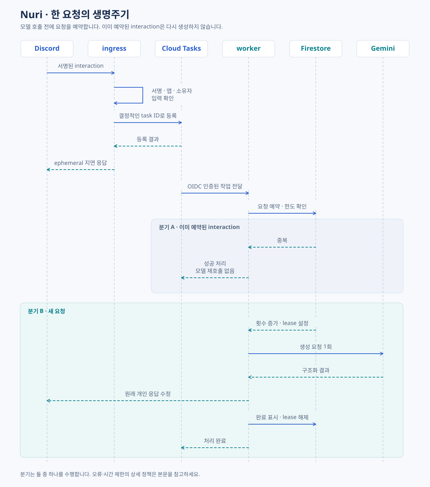

[언어 선택](Home.md) · [한국어](Architecture.md) · [English](Architecture-en.md) · [简体中文](Architecture-zh-CN.md)

# 아키텍처

**짧은 요청 수신과 긴 모델 처리를 분리하고, 사용량과 중복 방지는 Firestore에서 공유합니다.**

## 전체 구조

## 구성 요소

| 구성 | 책임 | 구현 위치 |
|---|---|---|
| HTTP ingress | 요청 서명·앱·소유자·입력 확인, 작업 등록, 지연 응답 | `nuri/cloud_http.py` |
| 작업 대기열 | 안정적인 task ID, OIDC 호출, 등록 시간 제한 | `nuri/cloud_queue.py` |
| worker | 입력 재검증, 사용량 예약, 모델 호출, 개인 응답 전달 | `nuri/cloud_http.py` |
| 공유 상태 | KST 일일 횟수, 전역 lease, 해시 기반 중복 방지 | `nuri/cloud_state.py` |
| 모델 어댑터 | 단일 생성 요청, 구조화 응답 검증 | `nuri/provider.py` |
| 선택 메시지 추출 | 본문과 embed의 텍스트 결합 | `nuri/selected_message.py` |
| 결과 표시 | 번역 우선 본문, 페이지 분할, Markdown 이스케이프 | `nuri/render.py` |

## 한 요청의 생명주기

Cloud Tasks에는 짧은 전달 지연을 두어 최초 Discord 응답 전에 worker가 결과를 수정하는 경합을 줄입니다. 대기열 등록 경로는 전체 2.3초로 제한하지만, Cloud Run 인스턴스 시작 시간까지 없애지는 못합니다.

## 중복과 실패의 의미

Firestore는 **모델 호출 전에** interaction을 예약합니다. 예약된 interaction이 다시 전달되면 모델을 재호출하지 않습니다. worker가 중간에 종료된 경우에도 같은 interaction으로 자동 복구하지 않아 응답을 놓칠 수 있습니다. 이는 중복 생성과 예측하기 어려운 사용량 증가를 막는 현재 정책입니다.

전역 lease는 300초이며 실제 작업에는 더 짧은 제한이 있습니다. Cloud Run의 요청 시간 제한만으로 Python 작업이 끝났다고 가정하지 않습니다. 일반 처리에서는 완료 시 lease를 해제하고, 비정상 종료 뒤에는 만료 후 다음 요청을 받을 수 있습니다.

대기열의 **작업 전달 재시도**와 Gemini의 **생성 재시도**는 별개입니다. 전달 정책은 기존 Cloud Tasks 설정을 따르며, 애플리케이션은 모델 생성을 자동 재시도하지 않습니다.

**다음:** [운영 →](Operations.md) · [보안과 데이터](Security.md)
